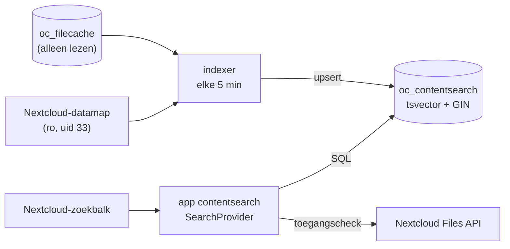

# contentsearch

Een Nextcloud-app die de **inhoud** van documenten doorzoekbaar maakt in de gewone zoekbalk (Unified Search), zonder Elasticsearch. De index is een `tsvector`-tabel in de PostgreSQL-database van Nextcloud zelf. Een losse indexer-container houdt die bij. In rust kost het vrijwel geen RAM, en het is gebouwd voor een Raspberry Pi 5 (arm64, 8 GB).

## Hoe het werkt



| | |
|---|---|
| Index | Tabel `oc_contentsearch` in de database `nextcloud`, met een `tsvector`-kolom (`dutch`, met stemming) en een GIN-index |
| Indexer | Container met Debian trixie, Python, `pdftotext`, `catdoc` en `ocrmypdf`. Leest `oc_filecache` en de bestanden **read-only**, en schrijft alleen in zijn eigen tabel |
| Zoeken | Nextcloud-app `contentsearch`, die één `IProvider` registreert. Hij toont een groep **Inhoud** in de zoekbalk |
| Rechten | Elke treffer wordt gecontroleerd met `getUserFolder($uid)->getFirstNodeById()`. Wat een gebruiker niet mag zien, valt weg. Gedeelde bestanden werken gewoon |
| Wijzigingen | Opnieuw indexeren als de `etag` in `oc_filecache` verandert. Verdwenen of naar de prullenbak verplaatste bestanden worden uit de index gehaald |
| OCR | Optioneel (`OCR=1`). Zonder OCR krijgen scans de status `needs_ocr`, en ze worden opgepakt zodra OCR aan staat |
| Bereik | Opslag `home::<user>`, paden onder `files/`. Formaten: pdf, doc, docx, pptx, xlsx, odt, ods, odp, txt en md |

**Waarom zo:** tekst uit bestanden halen en OCR zijn het enige zware werk, en dat gebeurt één keer per document. Zoeken is daarna één SQL-query. De indexer staat los van Nextcloud, dus het Nextcloud-image hoeft niet aangepast te worden. Valt de indexer uit, dan blijft Nextcloud gewoon werken.

## Repo-indeling

```
nextcloud-contentsearch/
├── app/                 # de Nextcloud-app → custom_apps/contentsearch
│   ├── appinfo/info.xml
│   └── lib/
│       ├── AppInfo/Application.php
│       └── Search/SearchProvider.php
├── indexer/             # de indexer-container
│   ├── Dockerfile
│   └── indexer.py
├── sql/setup.sql        # rol en tabel, eenmalig als postgres-superuser
└── dev/                 # lokale testomgeving (Nextcloud + PostgreSQL)
```

## Vereisten

- Nextcloud 35 op **PostgreSQL**, met `dbtableprefix` `oc_`
- Docker met Compose op de server
- De Nextcloud-datamap is leesbaar voor uid/gid 33 (`www-data`)

## Installeren

`occ app:install` werkt alleen met de app store. Deze app installeer je door de map `app/` in `custom_apps/` te zetten en daarna `occ app:enable` te draaien. Een app zonder handtekening van de app store wordt niet op integriteit gecontroleerd.

De stappen hieronder gaan uit van Nextcloud in Docker (container `nextcloud_app`, volume `nextcloud_nextcloud_html`) en een PostgreSQL-container `postgres-shared` op het netwerk `postgres-net`. Pas de waarden aan als jouw situatie anders is:

```bash
APP_ID=contentsearch
REPO=https://github.com/sthewessen/nextcloud-contentsearch.git
SRC=/opt/$APP_ID
APPS=/var/lib/docker/volumes/nextcloud_nextcloud_html/_data/custom_apps
NC_URL=https://<nextcloud-host>
```

### 1. Repo clonen (server, `sudo`)

```bash
sudo git clone "$REPO" "$SRC"
ls "$SRC"
```

Verwacht resultaat: `app  dev  indexer  sql`.

### 2. Database-rol en tabel (server)

Het wachtwoord komt binnen als psql-variabele en staat dus nergens in de repo. Het gaat direct naar de `.env` van de indexer-stack:

```bash
sudo mkdir -p /opt/stacks/$APP_ID
PW=$(openssl rand -hex 24)
printf 'PGPASSWORD=%s\n' "$PW" | sudo tee /opt/stacks/$APP_ID/.env >/dev/null
sudo chmod 600 /opt/stacks/$APP_ID/.env

docker exec -i postgres-shared psql -U postgres -d nextcloud -v ON_ERROR_STOP=1 -v pw="$PW" < "$SRC/sql/setup.sql"
unset PW
```

Verwacht resultaat: `CREATE ROLE`, `GRANT`, `GRANT`, `CREATE TABLE`, `CREATE INDEX`, `ALTER TABLE` en `GRANT`. Controleer daarna:

```bash
docker exec postgres-shared psql -U postgres -d nextcloud -c '\dp oc_contentsearch'
```

Verwacht resultaat: `contentsearch_indexer` heeft alle rechten en `nextcloud` heeft `r` (lezen).

### 3. Indexer starten (server, `sudo`)

```bash
sudo tee /opt/stacks/$APP_ID/compose.yaml >/dev/null <<'EOF'
name: contentsearch

services:
  indexer:
    build: /opt/contentsearch/indexer
    image: contentsearch-indexer:local
    container_name: contentsearch_indexer
    restart: unless-stopped
    mem_limit: 512m
    memswap_limit: 512m
    networks:
      - postgres-net
    volumes:
      - /srv/data/nextcloud/data:/data:ro
    tmpfs:
      - /tmp:size=256m
    env_file:
      - .env
    environment:
      PGHOST: postgres-shared
      PGDATABASE: nextcloud
      PGUSER: contentsearch_indexer
      BATCH: "200"
      INTERVAL: "300"
      OCR: "0"

networks:
  postgres-net:
    external: true
EOF

cd /opt/stacks/$APP_ID && sudo docker compose up -d --build
docker logs -f contentsearch_indexer
```

Verwacht resultaat: een aantal keer `indexed 200`, en daarna `indexed <n>` met n < 200, waarna de indexer vijf minuten wacht. Voortgang volgen:

```bash
docker exec postgres-shared psql -U postgres -d nextcloud -c \
  "select status, count(*), pg_size_pretty(sum(length(content))::bigint) from oc_contentsearch group by 1"
```

### 4. App installeren (server, `sudo`)

```bash
sudo rsync -a --delete --chown=33:33 "$SRC/app/" "$APPS/$APP_ID/"
docker exec -u www-data nextcloud_app php occ app:enable $APP_ID
```

Verwacht resultaat: `contentsearch 0.1.0 enabled`. De cron-container gebruikt hetzelfde volume en ziet de app daardoor automatisch.

### 5. Testen

Met een app-wachtwoord (Instellingen → Beveiliging → *Apparaten & sessies*):

```bash
curl -s -u <gebruiker>:<app-wachtwoord> -H 'OCS-APIRequest: true' \
  "$NC_URL/ocs/v2.php/search/providers/contentsearch/search?term=factuur&format=json" \
  | python3 -m json.tool | head -30
```

Verwacht resultaat: `"name": "Inhoud"` met `entries`, waarbij elke `subline` een tekstfragment met «markering» is. In de browser zie je in de zoekbalk een groep **Inhoud**.

**Rechten:** zoek met een tweede gebruiker op een woord dat alleen in de bestanden van de eerste gebruiker staat. Verwacht resultaat: geen treffers onder *Inhoud*. Fouten van de app staan in het Nextcloud-log:

```bash
docker exec -u www-data nextcloud_app php occ log:tail 20
```

### 6. OCR aanzetten (optioneel, server, `sudo`)

Pas als de eerste indexeerrun klaar is, en bij voorkeur 's nachts. Kijk eerst hoeveel er te doen is:

```bash
docker exec postgres-shared psql -U postgres -d nextcloud -Atc \
  "select count(*) from oc_contentsearch where status = 'needs_ocr'"

sudo sed -i 's/OCR: "0"/OCR: "1"/' /opt/stacks/$APP_ID/compose.yaml
cd /opt/stacks/$APP_ID && sudo docker compose up -d
docker stats --no-stream contentsearch_indexer
```

Verwacht resultaat: het geheugen blijft onder de 512 MiB. De status gaat van `needs_ocr` naar `ocr`.

## Bijwerken (server, `sudo`)

```bash
cd "$SRC" && sudo git pull
cd /opt/stacks/$APP_ID && sudo docker compose up -d --build
sudo rsync -a --delete --chown=33:33 "$SRC/app/" "$APPS/$APP_ID/"
docker exec -u www-data nextcloud_app php occ upgrade
```

- Een wijziging in `app/` vraagt een hoger `<version>` in `app/appinfo/info.xml`. Anders draait `occ upgrade` niets, en kan de cache van Nextcloud de oude code blijven gebruiken.
- Zet vóór een major-upgrade van Nextcloud eerst `max-version` in `info.xml` op de nieuwe versie, en rol dat uit. Anders schakelt de upgrade de app uit.

## Verwijderen

```bash
docker exec -u www-data nextcloud_app php occ app:disable $APP_ID
sudo rm -rf "$APPS/$APP_ID"
cd /opt/stacks/$APP_ID && sudo docker compose down
docker exec postgres-shared psql -U postgres -d nextcloud -c \
  'DROP TABLE oc_contentsearch; REVOKE ALL ON oc_filecache, oc_storages, oc_mimetypes FROM contentsearch_indexer; REVOKE CONNECT ON DATABASE nextcloud FROM contentsearch_indexer; DROP ROLE contentsearch_indexer;'
```

## Bekende beperkingen

- Alleen bestanden die Nextcloud zelf kent, dus wat in `oc_filecache` staat. Bestanden die buiten Nextcloud om op schijf worden gezet, komen er pas in na `occ files:scan`.
- Rangschikking en paginering lopen over de hele index, en treffers van andere gebruikers worden daarna weggefilterd. Een pagina kan daardoor minder resultaten tonen dan de limiet.
- De `dutch`-stemming geldt ook voor Engelse tekst. Hele woorden worden goed gevonden, Engelse verbuigingen minder.
- Het zoekveld in de Files-app blijft alleen op bestandsnaam zoeken. Deze app werkt via de zoekbalk bovenin (Unified Search).

## Bronnen

- [Nextcloud developer docs: Search](https://docs.nextcloud.com/server/latest/developer_manual/digging_deeper/search.html)
- [Nextcloud developer docs: App metadata (info.xml)](https://docs.nextcloud.com/server/latest/developer_manual/app_development/info.html)
- [PostgreSQL: Full Text Search](https://www.postgresql.org/docs/current/textsearch.html)
- [PostgreSQL: tsvector size limits](https://www.postgresql.org/docs/current/textsearch-limitations.html)
- [OCRmyPDF: sidecar output](https://ocrmypdf.readthedocs.io/en/latest/cookbook.html)

<!-- AGENT-INSTRUCTIONS:START — deze hele sectie verwijderen zodra v0.1 werkt -->

## Instructies voor de agent die de app bouwt

Je bouwt v0.1 van deze repo: de bestanden uit *Repo-indeling*, plus een lokale testomgeving. Alles hierboven in deze README is de specificatie. Op het punt waar de README en jouw implementatie uiteenlopen, pas je de README aan, of je vraagt het eerst.

### Werkwijze

- **Bouw en test alleen lokaal**, op de Mac (Docker Desktop, arm64, net als de Pi). Draai niets op de productieserver (`pi5`), ook niets dat alleen leest. Installeren daar doet Samuel zelf, met de stappen hierboven.
- **Geen secrets in de repo.** Wachtwoorden voor de dev-omgeving staan in `dev/.env`. Zet dat bestand in `.gitignore`, en voeg een `dev/.env.example` toe.
- **Commit en push alleen als Samuel daarom vraagt.**
- **Geen nieuwe afhankelijkheden zonder reden.** PHP: alleen de publieke `OCP`-API, geen Composer-pakketten. Python: stdlib en `psycopg` (v3), en die komen via apt, niet via pip.
- **Stijl:**
  - PHP: de codestijl van Nextcloud (tabs, `declare(strict_types=1);`).
  - Python: PEP 8.
  - Commentaar in het Engels, en spaarzaam.
- Voeg een `LICENSE` toe met AGPL-3.0-or-later, passend bij `<licence>agpl</licence>`.

### Vaste afspraken (niet veranderen zonder overleg)

| | |
|---|---|
| App-id / namespace | `contentsearch` / `OCA\ContentSearch` |
| Weergavenaam van de provider | `Inhoud` |
| Tabel | `oc_contentsearch`, schema zoals in `sql/setup.sql` hieronder. Kolom `status` ∈ `ok`, `needs_ocr`, `ocr`, `error` |
| Rollen | `contentsearch_indexer` is eigenaar van de tabel en heeft alleen `SELECT` op `oc_filecache`, `oc_storages` en `oc_mimetypes`. `nextcloud` heeft alleen `SELECT` op `oc_contentsearch` |
| Indexer | Draait als `33:33` en leest de datamap read-only via `/data`. Configuratie alleen via env (`PG*`, `BATCH`, `INTERVAL`, `OCR`). Moet binnen `mem_limit: 512m` blijven, ook met OCR |
| Afkappen | `content` maximaal 500.000 tekens, en `\x00` verwijderd, want `tsvector` mag maximaal 1 MB zijn |
| Compatibiliteit | Nextcloud 35 (`min-version` = `max-version` = 35), PHP 8.5, PostgreSQL 18, `linux/arm64` |

### Wat je bouwt

1. **De bestanden uit *Repo-indeling*.** Begin met de startversies hieronder. Die zijn op basis van de API-documentatie geschreven en **nog nooit gedraaid**: ga ervan uit dat er fouten in zitten.
2. **`dev/compose.yaml`**, een lokale testomgeving met:
   - `nextcloud:35-apache` op `postgres:18-alpine`, met `app/` als bind mount op `/var/www/html/custom_apps/contentsearch`;
   - de indexer, gebouwd uit `indexer/`, met de datamap van Nextcloud read-only gekoppeld.

   `sql/setup.sql` kan pas draaien als Nextcloud geïnstalleerd is, want `oc_filecache` moet dan al bestaan. Leg de volgorde vast in `dev/README.md`, of in een script `dev/up.sh`.
3. **Testbestanden** in `dev/fixtures/`, klein, met per formaat een herkenbaar uniek woord: pdf met tekst, gescande pdf (alleen een afbeelding), docx, doc, pptx, xlsx, odt en md. Mag gegenereerd worden met een script in plaats van binaire bestanden te committen.
4. **Unit-tests voor `extract()`** in `indexer/test_indexer.py`, uit te voeren in het indexer-image (`python3 -m unittest`). Daarvoor mag `python3-pytest` niet nodig zijn.

### Onzekerheden in de startversie die je moet controleren

- `IDBConnection::executeQuery()` vervangt `*PREFIX*` in ruwe SQL, en `LIMIT ?`/`OFFSET ?` werken met `PARAM_INT`.
- De routenamen `core.Preview.getPreviewByFileId` en `files.View.showFile` bestaan in Nextcloud 35.
- `Folder::getFirstNodeById()` bestaat (sinds Nextcloud 29) en geeft `null` terug voor bestanden zonder toegang.
- De optiestring van `ts_headline` accepteert `«`/`»` als `StartSel`/`StopSel`.
- De apt-pakketten `catdoc`, `ocrmypdf`, `tesseract-ocr-nld` en `python3-psycopg` bestaan in Debian trixie voor arm64.
- `ocrmypdf --sidecar` met een tijdelijk uitvoerbestand werkt met `--jobs 1` binnen 512 MB, ook voor een PDF van meerdere pagina's.
- Het `<database>pgsql</database>`-element in `info.xml` wordt geaccepteerd door `occ app:enable`.

### Klaar als

Draai elk punt echt en rapporteer de uitvoer:

1. `docker run --rm -v "$PWD/app:/app" php:8.5-cli sh -c 'find /app -name "*.php" -exec php -l {} \;'` geeft geen fouten.
2. `docker build --platform linux/arm64 -t contentsearch-indexer:dev indexer` slaagt, en de unit-tests slagen in dat image.
3. In de dev-omgeving:
   - `occ app:enable contentsearch` slaagt.
   - Na het uploaden van de fixtures via WebDAV staan ze in `oc_contentsearch`. Elk heeft status `ok`, behalve de scan, die `needs_ocr` heeft. Met `OCR=1` wordt de scan `ocr`.
   - De OCS-zoekopdracht uit stap 5 geeft per uniek woord het juiste bestand terug, met een snippet.
   - Een tweede gebruiker ziet de bestanden van de eerste niet, maar ziet een bestand wél zodra het met hem gedeeld is.
   - Een bestand wijzigen leidt in de volgende run tot herindexering. Een bestand verwijderen leidt in de volgende run tot een verwijderde rij.
   - `docker stats` laat zien dat de indexer tijdens OCR onder de 512 MiB blijft.
4. De README klopt nog met wat er gebouwd is: paden, verwachte uitvoer en beperkingen.

### Buiten scope voor v0.1

Een instellingenpagina, publicatie in de app store, andere databases dan PostgreSQL, event-listeners in plaats van polling, vector search en zoeken via het zoekveld van de Files-app.

### Startversies

<details>
<summary><code>app/appinfo/info.xml</code></summary>

```xml
<?xml version="1.0"?>
<info xmlns:xsi="http://www.w3.org/2001/XMLSchema-instance"
      xsi:noNamespaceSchemaLocation="https://apps.nextcloud.com/schema/apps/info.xsd">
    <id>contentsearch</id>
    <name>Content search</name>
    <summary>Zoek in de inhoud van bestanden via PostgreSQL full-text search</summary>
    <description>Unified Search-provider op een tsvector-index die een losse indexer bijhoudt.</description>
    <version>0.1.0</version>
    <licence>agpl</licence>
    <author>Samuel Thewessen</author>
    <namespace>ContentSearch</namespace>
    <category>search</category>
    <dependencies>
        <database>pgsql</database>
        <nextcloud min-version="35" max-version="35"/>
    </dependencies>
</info>
```

</details>

<details>
<summary><code>app/lib/AppInfo/Application.php</code></summary>

```php
<?php

declare(strict_types=1);

namespace OCA\ContentSearch\AppInfo;

use OCA\ContentSearch\Search\SearchProvider;
use OCP\AppFramework\App;
use OCP\AppFramework\Bootstrap\IBootContext;
use OCP\AppFramework\Bootstrap\IBootstrap;
use OCP\AppFramework\Bootstrap\IRegistrationContext;

class Application extends App implements IBootstrap {
	public const APP_ID = 'contentsearch';

	public function __construct() {
		parent::__construct(self::APP_ID);
	}

	public function register(IRegistrationContext $context): void {
		$context->registerSearchProvider(SearchProvider::class);
	}

	public function boot(IBootContext $context): void {
	}
}
```

</details>

<details>
<summary><code>app/lib/Search/SearchProvider.php</code></summary>

```php
<?php

declare(strict_types=1);

namespace OCA\ContentSearch\Search;

use OCP\DB\QueryBuilder\IQueryBuilder;
use OCP\Files\IRootFolder;
use OCP\IDBConnection;
use OCP\IURLGenerator;
use OCP\IUser;
use OCP\Search\IProvider;
use OCP\Search\ISearchQuery;
use OCP\Search\SearchResult;
use OCP\Search\SearchResultEntry;

class SearchProvider implements IProvider {
	private const SQL = <<<'SQL'
		WITH q AS (SELECT websearch_to_tsquery('dutch', ?) AS q),
		hit AS (
			SELECT c.fileid, c.content, ts_rank(c.tsv, q.q) AS rank
			FROM *PREFIX*contentsearch c, q
			WHERE c.tsv @@ q.q
			ORDER BY rank DESC
			LIMIT ? OFFSET ?
		)
		SELECT hit.fileid,
		       ts_headline('dutch', left(hit.content, 100000), q.q,
		                   'MaxWords=20, MinWords=8, StartSel=«, StopSel=»') AS snippet
		FROM hit, q
		ORDER BY hit.rank DESC
		SQL;

	public function __construct(
		private IDBConnection $db,
		private IRootFolder $rootFolder,
		private IURLGenerator $url,
	) {
	}

	public function getId(): string {
		return 'contentsearch';
	}

	public function getName(): string {
		return 'Inhoud';
	}

	public function getOrder(string $route, array $routeParameters): int {
		return 10;
	}

	public function search(IUser $user, ISearchQuery $query): SearchResult {
		$term = trim($query->getTerm());
		if (mb_strlen($term) < 3) {
			return SearchResult::complete($this->getName(), []);
		}
		$limit = $query->getLimit();
		$offset = (int)($query->getCursor() ?? 0);

		$rows = $this->db->executeQuery(
			self::SQL,
			[$term, $limit, $offset],
			[IQueryBuilder::PARAM_STR, IQueryBuilder::PARAM_INT, IQueryBuilder::PARAM_INT],
		)->fetchAll();

		$userFolder = $this->rootFolder->getUserFolder($user->getUID());
		$entries = [];
		foreach ($rows as $row) {
			// Not owned by or shared with this user: skip
			$node = $userFolder->getFirstNodeById((int)$row['fileid']);
			if ($node === null) {
				continue;
			}
			$entries[] = new SearchResultEntry(
				$this->url->linkToRouteAbsolute('core.Preview.getPreviewByFileId', ['x' => 32, 'y' => 32, 'fileId' => $node->getId()]),
				$node->getName(),
				$row['snippet'],
				$this->url->linkToRouteAbsolute('files.View.showFile', ['fileid' => $node->getId()]),
				'icon-filetype-file',
			);
		}

		return SearchResult::paginated($this->getName(), $entries, $offset + $limit);
	}
}
```

</details>

<details>
<summary><code>sql/setup.sql</code></summary>

```sql
CREATE ROLE contentsearch_indexer LOGIN PASSWORD :'pw';
GRANT CONNECT ON DATABASE nextcloud TO contentsearch_indexer;
GRANT SELECT ON oc_filecache, oc_storages, oc_mimetypes TO contentsearch_indexer;

CREATE TABLE oc_contentsearch (
    fileid     bigint PRIMARY KEY,
    storage    bigint NOT NULL,
    etag       text NOT NULL,
    status     text NOT NULL,          -- ok | needs_ocr | ocr | error
    content    text,
    tsv        tsvector GENERATED ALWAYS AS (to_tsvector('dutch', coalesce(content, ''))) STORED,
    indexed_at timestamptz NOT NULL DEFAULT now()
);
CREATE INDEX oc_contentsearch_tsv ON oc_contentsearch USING gin (tsv);
ALTER TABLE oc_contentsearch OWNER TO contentsearch_indexer;
GRANT SELECT ON oc_contentsearch TO nextcloud;
```

</details>

<details>
<summary><code>indexer/indexer.py</code></summary>

```python
#!/usr/bin/env python3
"""Index the text of Nextcloud files into oc_contentsearch (PostgreSQL full-text search)."""
import html
import os
import re
import subprocess
import tempfile
import time
import zipfile

import psycopg

DATA = "/data"
BATCH = int(os.environ.get("BATCH", "200"))
INTERVAL = int(os.environ.get("INTERVAL", "300"))
OCR = os.environ.get("OCR", "0") == "1"
MAX_CHARS = 500_000  # tsvector is capped at 1 MB

# Office formats are zip files; text lives in these XML parts
ZIP_PARTS = {
    "application/vnd.openxmlformats-officedocument.wordprocessingml.document": r"word/document\.xml",
    "application/vnd.openxmlformats-officedocument.presentationml.presentation": r"ppt/slides/slide\d+\.xml",
    "application/vnd.openxmlformats-officedocument.spreadsheetml.sheet": r"xl/sharedStrings\.xml",
    "application/vnd.oasis.opendocument.text": r"content\.xml",
    "application/vnd.oasis.opendocument.spreadsheet": r"content\.xml",
    "application/vnd.oasis.opendocument.presentation": r"content\.xml",
}
MIMES = ["application/pdf", "application/msword", "text/plain", "text/markdown", *ZIP_PARTS]

PENDING = """
SELECT f.fileid, f.storage, s.id, f.path, f.etag, m.mimetype
FROM oc_filecache f
JOIN oc_storages s ON s.numeric_id = f.storage
JOIN oc_mimetypes m ON m.id = f.mimetype
LEFT JOIN oc_contentsearch c ON c.fileid = f.fileid
WHERE s.id LIKE 'home::%%' AND f.path LIKE 'files/%%'
  AND m.mimetype = ANY(%(mimes)s)
  AND (c.fileid IS NULL OR c.etag <> f.etag OR (%(ocr)s AND c.status = 'needs_ocr'))
ORDER BY f.mtime DESC
LIMIT %(batch)s
"""

# Gone from the filecache, or moved to the trash bin (path no longer under files/)
CLEANUP = """
DELETE FROM oc_contentsearch c
WHERE NOT EXISTS (SELECT 1 FROM oc_filecache f WHERE f.fileid = c.fileid AND f.path LIKE 'files/%%')
"""

UPSERT = """
INSERT INTO oc_contentsearch (fileid, storage, etag, status, content)
VALUES (%s, %s, %s, %s, %s)
ON CONFLICT (fileid) DO UPDATE
SET etag = EXCLUDED.etag, status = EXCLUDED.status, content = EXCLUDED.content, indexed_at = now()
"""


def run(cmd):
    out = subprocess.run(cmd, capture_output=True, timeout=600, check=True).stdout
    return out.decode("utf-8", "replace")


def from_zip(path, pattern):
    with zipfile.ZipFile(path) as z:
        xml = " ".join(z.read(n).decode("utf-8", "replace")
                       for n in sorted(z.namelist()) if re.fullmatch(pattern, n))
    xml = re.sub(r"</(w:p|a:p|text:p|text:h)>", "\n", xml)
    return html.unescape(re.sub(r"<[^>]+>", " ", xml))


def ocr(path):
    with tempfile.TemporaryDirectory() as tmp:
        sidecar = os.path.join(tmp, "out.txt")
        subprocess.run(["ocrmypdf", "-l", "nld+eng", "--skip-text", "--jobs", "1",
                        "--sidecar", sidecar, path, os.path.join(tmp, "out.pdf")],
                       capture_output=True, timeout=1800, check=True)
        with open(sidecar, encoding="utf-8", errors="replace") as f:
            return f.read()


def extract(path, mime):
    if mime == "application/pdf":
        text = run(["pdftotext", "-enc", "UTF-8", path, "-"])
        if len(text.strip()) >= 100:
            return text, "ok"
        return (ocr(path), "ocr") if OCR else (None, "needs_ocr")
    if mime == "application/msword":
        return run(["catdoc", "-d", "utf-8", path]), "ok"
    if mime in ZIP_PARTS:
        return from_zip(path, ZIP_PARTS[mime]), "ok"
    with open(path, encoding="utf-8", errors="replace") as f:
        return f.read(MAX_CHARS), "ok"


def main():
    # Connection settings come from the PG* environment variables
    with psycopg.connect(autocommit=True) as db:
        while True:
            db.execute(CLEANUP)
            rows = db.execute(PENDING, {"mimes": MIMES, "ocr": OCR, "batch": BATCH}).fetchall()
            for fileid, storage, storage_id, path, etag, mime in rows:
                full = os.path.join(DATA, storage_id.split("::", 1)[1], path)
                try:
                    text, status = extract(full, mime)
                except Exception as e:
                    print(f"error {fileid} {path}: {e}", flush=True)
                    text, status = None, "error"
                if text is not None:
                    text = text.replace("\x00", "")[:MAX_CHARS]
                try:
                    db.execute(UPSERT, (fileid, storage, etag, status, text))
                except psycopg.Error as e:
                    print(f"error {fileid} {path}: {e}", flush=True)
                    db.execute(UPSERT, (fileid, storage, etag, "error", None))
            print(f"indexed {len(rows)}", flush=True)
            if len(rows) < BATCH:
                time.sleep(INTERVAL)


if __name__ == "__main__":
    main()
```

</details>

<details>
<summary><code>indexer/Dockerfile</code></summary>

```dockerfile
FROM debian:trixie-slim
RUN apt-get update \
 && apt-get install -y --no-install-recommends \
      python3 python3-psycopg poppler-utils catdoc \
      ocrmypdf tesseract-ocr-nld tesseract-ocr-eng \
 && rm -rf /var/lib/apt/lists/*
COPY indexer.py /usr/local/bin/indexer.py
ENV PYTHONUNBUFFERED=1 OMP_THREAD_LIMIT=1
USER 33:33
ENTRYPOINT ["python3", "/usr/local/bin/indexer.py"]
```

</details>

<!-- AGENT-INSTRUCTIONS:END -->
