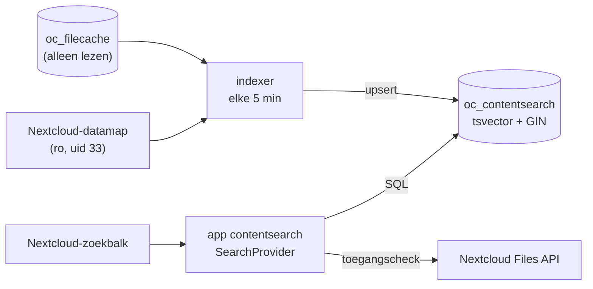

# contentsearch

Een Nextcloud-app die de **inhoud** van documenten doorzoekbaar maakt in de gewone zoekbalk (Unified Search), zonder Elasticsearch. De index is een `tsvector`-tabel in de PostgreSQL-database van Nextcloud zelf. Een losse indexer-container houdt die bij. In rust kost het vrijwel geen RAM, en het is gebouwd voor een Raspberry Pi 5 (arm64, 8 GB).

## Hoe het werkt



| | |
|---|---|
| Index | Tabel `oc_contentsearch` in de database `nextcloud`, met een `tsvector`-kolom (`dutch`, met stemming) en een GIN-index |
| Indexer | Container met Debian trixie, Python, `pdftotext`, `catdoc` en `ocrmypdf`. Leest `oc_filecache` en de bestanden **read-only**, en schrijft alleen in zijn eigen tabel |
| Zoeken | Nextcloud-app `contentsearch`, die één `IProvider` registreert. Hij toont een groep **Inhoud** in de zoekbalk |
| Rechten | Elke treffer wordt gecontroleerd met `getUserFolder($uid)->getFirstNodeById()`. Wat een gebruiker niet mag zien, valt weg. Gedeelde bestanden werken gewoon |
| Wijzigingen | Opnieuw indexeren als de `etag` in `oc_filecache` verandert. Verdwenen of naar de prullenbak verplaatste bestanden worden uit de index gehaald |
| OCR | Optioneel (`OCR=1`). Zonder OCR krijgen scans de status `needs_ocr`, en ze worden opgepakt zodra OCR aan staat |
| Bereik | Opslag `home::<user>`, paden onder `files/`. Formaten: pdf, doc, docx, pptx, xlsx, odt, ods, odp, txt en md |

**Waarom zo:** tekst uit bestanden halen en OCR zijn het enige zware werk, en dat gebeurt één keer per document. Zoeken is daarna één SQL-query. De indexer staat los van Nextcloud, dus het Nextcloud-image hoeft niet aangepast te worden. Valt de indexer uit, dan blijft Nextcloud gewoon werken.

## Repo-indeling

```
nextcloud-contentsearch/
├── app/                 # de Nextcloud-app → custom_apps/contentsearch
│   ├── appinfo/info.xml
│   └── lib/
│       ├── AppInfo/Application.php
│       └── Search/SearchProvider.php
├── indexer/             # de indexer-container
│   ├── Dockerfile
│   ├── indexer.py
│   └── test_indexer.py  # unit-tests voor extract()
├── sql/setup.sql        # rol en tabel, eenmalig als postgres-superuser
├── dev/                 # lokale testomgeving (Nextcloud + PostgreSQL)
│   ├── compose.yaml
│   ├── up.sh            # start alles in de juiste volgorde
│   ├── e2e.sh           # end-to-end-controle
│   └── fixtures/        # generate.sh maakt testbestanden in fixtures/out/
└── LICENSE              # AGPL-3.0-or-later
```

## Vereisten

- Nextcloud 35 op **PostgreSQL**, met `dbtableprefix` `oc_`
- Docker met Compose op de server
- De Nextcloud-datamap is leesbaar voor uid/gid 33 (`www-data`)

## Installeren

`occ app:install` werkt alleen met de app store. Deze app installeer je door de map `app/` in `custom_apps/` te zetten en daarna `occ app:enable` te draaien. Een app zonder handtekening van de app store wordt niet op integriteit gecontroleerd.

De stappen hieronder gaan uit van Nextcloud in Docker (container `nextcloud_app`, volume `nextcloud_nextcloud_html`) en een PostgreSQL-container `postgres-shared` op het netwerk `postgres-net`. Pas de waarden aan als jouw situatie anders is:

```bash
APP_ID=contentsearch
REPO=https://github.com/sthewessen/nextcloud-contentsearch.git
SRC=/opt/$APP_ID
APPS=/var/lib/docker/volumes/nextcloud_nextcloud_html/_data/custom_apps
NC_URL=https://<nextcloud-host>
```

### 1. Repo clonen (server, `sudo`)

```bash
sudo git clone "$REPO" "$SRC"
ls "$SRC"
```

Verwacht resultaat: `app  dev  indexer  sql`.

### 2. Database-rol en tabel (server)

Het wachtwoord komt binnen als psql-variabele en staat dus nergens in de repo. Het gaat direct naar de `.env` van de indexer-stack:

```bash
sudo mkdir -p /opt/stacks/$APP_ID
PW=$(openssl rand -hex 24)
printf 'PGPASSWORD=%s\n' "$PW" | sudo tee /opt/stacks/$APP_ID/.env >/dev/null
sudo chmod 600 /opt/stacks/$APP_ID/.env

docker exec -i postgres-shared psql -U postgres -d nextcloud -v ON_ERROR_STOP=1 -v pw="$PW" < "$SRC/sql/setup.sql"
unset PW
```

Verwacht resultaat: `CREATE ROLE`, `GRANT`, `GRANT`, `CREATE TABLE`, `CREATE INDEX`, `ALTER TABLE` en `GRANT`. Controleer daarna:

```bash
docker exec postgres-shared psql -U postgres -d nextcloud -c '\dp oc_contentsearch'
```

Verwacht resultaat: `contentsearch_indexer` heeft alle rechten en `nextcloud` heeft `r` (lezen).

### 3. Indexer starten (server, `sudo`)

```bash
sudo tee /opt/stacks/$APP_ID/compose.yaml >/dev/null <<'EOF'
name: contentsearch

services:
  indexer:
    build: /opt/contentsearch/indexer
    image: contentsearch-indexer:local
    container_name: contentsearch_indexer
    restart: unless-stopped
    mem_limit: 512m
    memswap_limit: 512m
    networks:
      - postgres-net
    volumes:
      - /srv/data/nextcloud/data:/data:ro
    tmpfs:
      - /tmp:size=256m
    env_file:
      - .env
    environment:
      PGHOST: postgres-shared
      PGDATABASE: nextcloud
      PGUSER: contentsearch_indexer
      BATCH: "200"
      INTERVAL: "300"
      OCR: "0"
      OCR_EXCLUDE: ""

networks:
  postgres-net:
    external: true
EOF

cd /opt/stacks/$APP_ID && sudo docker compose up -d --build
docker logs -f contentsearch_indexer
```

Verwacht resultaat: per bestand een regel zoals `ok 12345 files/Documenten/brief.docx (0.1 s)` of `ocr 12345 files/Scans/brief.pdf (16 p, 212.0 s)`, na elke ronde `indexed 200`, en daarna `indexed <n>` met n < 200, waarna de indexer vijf minuten wacht. Voortgang volgen:

```bash
docker exec postgres-shared psql -U postgres -d nextcloud -c \
  "select status, count(*), pg_size_pretty(sum(length(content))::bigint) from oc_contentsearch group by 1"
```

### 4. App installeren (server, `sudo`)

```bash
sudo rsync -a --delete --chown=33:33 "$SRC/app/" "$APPS/$APP_ID/"
docker exec -u www-data nextcloud_app php occ app:enable $APP_ID
```

Verwacht resultaat: `contentsearch 0.1.0 enabled`. De cron-container gebruikt hetzelfde volume en ziet de app daardoor automatisch.

### 5. Testen

Met een app-wachtwoord (Instellingen → Beveiliging → *Apparaten & sessies*):

```bash
curl -s -u <gebruiker>:<app-wachtwoord> -H 'OCS-APIRequest: true' \
  "$NC_URL/ocs/v2.php/search/providers/contentsearch/search?term=factuur&format=json" \
  | python3 -m json.tool | head -30
```

Verwacht resultaat: `"name": "Inhoud"` met `entries`, waarbij elke `subline` een tekstfragment met «markering» is. In de browser zie je in de zoekbalk een groep **Inhoud**.

**Rechten:** zoek met een tweede gebruiker op een woord dat alleen in de bestanden van de eerste gebruiker staat. Verwacht resultaat: geen treffers onder *Inhoud*. Fouten van de app staan in het Nextcloud-log:

```bash
docker exec -u www-data nextcloud_app php occ log:tail 20
```

### 6. OCR aanzetten (optioneel, server, `sudo`)

Pas als de eerste indexeerrun klaar is, en bij voorkeur 's nachts. Kijk eerst hoeveel er te doen is:

```bash
docker exec postgres-shared psql -U postgres -d nextcloud -Atc \
  "select count(*) from oc_contentsearch where status = 'needs_ocr'"

sudo sed -i 's/OCR: "0"/OCR: "1"/' /opt/stacks/$APP_ID/compose.yaml
cd /opt/stacks/$APP_ID && sudo docker compose up -d
docker stats --no-stream contentsearch_indexer
```

Mappen met scans waarvan OCR alleen onzin oplevert, zoals bladmuziek, kun je overslaan met `OCR_EXCLUDE`. Geef de mappen op vanaf de map `files` van elke gebruiker, gescheiden door komma's. Ze gelden voor alle gebruikers, en ook voor de submappen:

```bash
sudo sed -i 's|OCR_EXCLUDE: ""|OCR_EXCLUDE: "Resources/Sheetmusic"|' /opt/stacks/$APP_ID/compose.yaml
cd /opt/stacks/$APP_ID && sudo docker compose up -d
```

Scans in die mappen krijgen de status `ocr_excluded`. Haal je later een map uit de lijst, verwijder dan de rijen met `ocr_excluded`, zodat ze opnieuw worden bekeken.

Verwacht resultaat: het geheugen blijft onder de 512 MiB. Lokaal was de piek 286 MiB (`memory.peak` van de cgroup), bij een scan van 9 pagina's op 300 dpi. De status gaat van `needs_ocr` naar `ocr`. OCR draait met `--output-type none`: alleen de tekst wordt bewaard, en er wordt geen nieuwe PDF geschreven.

## Bijwerken (server, `sudo`)

```bash
cd "$SRC" && sudo git pull
cd /opt/stacks/$APP_ID && sudo docker compose up -d --build
sudo rsync -a --delete --chown=33:33 "$SRC/app/" "$APPS/$APP_ID/"
docker exec -u www-data nextcloud_app php occ upgrade
```

- Een wijziging in `app/` vraagt een hoger `<version>` in `app/appinfo/info.xml`. Anders draait `occ upgrade` niets, en kan de cache van Nextcloud de oude code blijven gebruiken.
- Een nieuwe indexer probeert bestanden met de status `error` niet vanzelf opnieuw, want hun etag is niet veranderd. Verwijder die rijen om ze één keer opnieuw te laten indexeren in de volgende ronde:

  ```bash
  docker exec postgres-shared psql -U postgres -d nextcloud -c \
    "delete from oc_contentsearch where status = 'error'"
  ```
- Zet vóór een major-upgrade van Nextcloud eerst `max-version` in `info.xml` op de nieuwe versie, en rol dat uit. Anders schakelt de upgrade de app uit.

## Verwijderen

```bash
docker exec -u www-data nextcloud_app php occ app:disable $APP_ID
sudo rm -rf "$APPS/$APP_ID"
cd /opt/stacks/$APP_ID && sudo docker compose down
docker exec postgres-shared psql -U postgres -d nextcloud -c \
  'DROP TABLE oc_contentsearch; REVOKE ALL ON oc_filecache, oc_storages, oc_mimetypes FROM contentsearch_indexer; REVOKE CONNECT ON DATABASE nextcloud FROM contentsearch_indexer; DROP ROLE contentsearch_indexer;'
```

## Bekende beperkingen

- Alleen bestanden die Nextcloud zelf kent, dus wat in `oc_filecache` staat. Bestanden die buiten Nextcloud om op schijf worden gezet, komen er pas in na `occ files:scan`.
- Rangschikking en paginering lopen over de hele index, en treffers van andere gebruikers worden daarna weggefilterd. Een pagina kan daardoor minder resultaten tonen dan de limiet.
- De `dutch`-stemming geldt ook voor Engelse tekst. Hele woorden worden goed gevonden, Engelse verbuigingen minder.
- Het zoekveld in de Files-app blijft alleen op bestandsnaam zoeken. Deze app werkt via de zoekbalk bovenin (Unified Search).
- Er wordt alleen op hele woorden gezocht, dus niet op het begin van een woord: `factuur` vindt «facturen», maar `fact` vindt niets.
- Een PDF met minder dan 100 tekens tekst geldt als scan (`needs_ocr`).
- Lege bestanden (0 bytes) krijgen de status `empty`.
- Docx, xlsx en pptx met een wachtwoord krijgen de status `encrypted`. Oude .doc- en .xls-bestanden met een wachtwoord gebruiken een andere versleuteling, en krijgen nog de status `error`.
- Bestanden die niet kunnen worden gelezen, krijgen de status `error`. Ze worden pas opnieuw geprobeerd als het bestand verandert.
- Van xlsx worden alleen tekstcellen geïndexeerd (`sharedStrings.xml`), dus geen getallen. Van pptx worden de dia's geïndexeerd, maar niet de notities.
- Nextcloud vervangt opslag-id's langer dan 64 tekens door een md5-hash. Bestanden van gebruikers met een gebruikersnaam van meer dan 58 tekens worden daardoor overgeslagen.

## Lokaal ontwikkelen en testen

Op een Mac met Docker Desktop (arm64), vanuit de root van de repo:

```bash
# PHP-syntaxcontrole
docker run --rm -v "$PWD/app:/app" php:8.5-cli sh -c 'find /app -name "*.php" -exec php -l {} \;'

# indexer-image en unit-tests
docker build --platform linux/arm64 -t contentsearch-indexer:dev indexer
dev/fixtures/generate.sh        # testbestanden → dev/fixtures/out/ (LibreOffice in een container)
docker run --rm -e PYTHONDONTWRITEBYTECODE=1 -e FIXTURES=/fx \
  -v "$PWD/indexer:/src:ro" -v "$PWD/dev/fixtures/out:/fx:ro" -w /src \
  --entrypoint python3 contentsearch-indexer:dev -m unittest -v

# testomgeving: Nextcloud op http://localhost:8089, gebruikers admin, alice en bob
dev/up.sh
dev/e2e.sh
```

`dev/up.sh` maakt bij de eerste keer `dev/.env` aan, met willekeurige wachtwoorden (zie `dev/.env.example`). Daarna start het de stappen in dezelfde volgorde als de installatie: eerst PostgreSQL en Nextcloud, en als Nextcloud geïnstalleerd is `sql/setup.sql`, `occ app:enable` en de indexer. De map `app/` is read-only gekoppeld op `custom_apps/contentsearch`, dus een PHP-wijziging werkt meteen. In de testomgeving draait de indexer elke 15 seconden.

`dev/e2e.sh` uploadt de testbestanden via WebDAV als alice. Daarna controleert het de status in `oc_contentsearch`, de zoekresultaten per uniek woord, de rechten van bob voor en na delen, herindexering na een wijziging, verwijdering, OCR met het geheugengebruik, `OCR_EXCLUDE`, en de logregels. Ook een lege, een versleutelde en een als .doc opgeslagen docx zitten erbij.

Opruimen: `cd dev && docker compose --profile indexer down -v`.

## Bronnen

- [Nextcloud developer docs: Search](https://docs.nextcloud.com/server/latest/developer_manual/digging_deeper/search.html)
- [Nextcloud developer docs: App metadata (info.xml)](https://docs.nextcloud.com/server/latest/developer_manual/app_development/info.html)
- [PostgreSQL: Full Text Search](https://www.postgresql.org/docs/current/textsearch.html)
- [PostgreSQL: tsvector size limits](https://www.postgresql.org/docs/current/textsearch-limitations.html)
- [OCRmyPDF: sidecar output](https://ocrmypdf.readthedocs.io/en/latest/cookbook.html)
